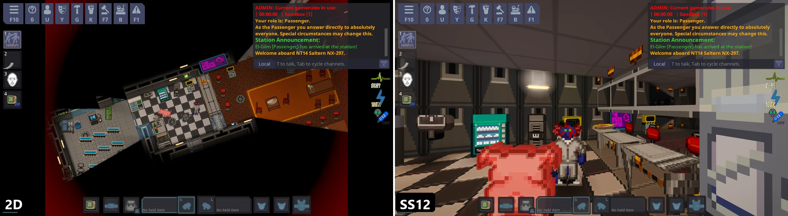
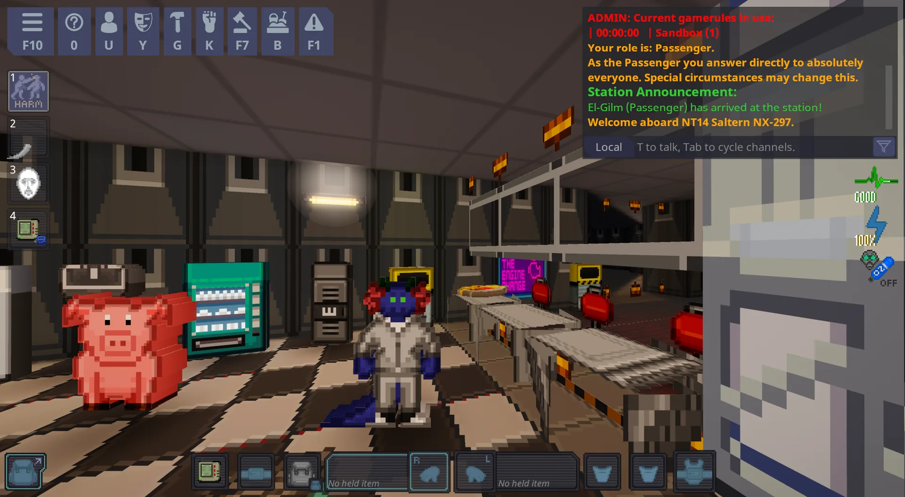
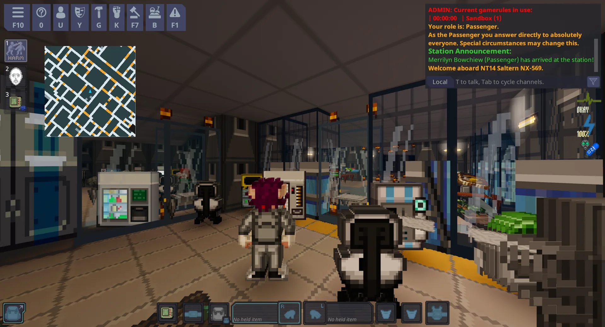
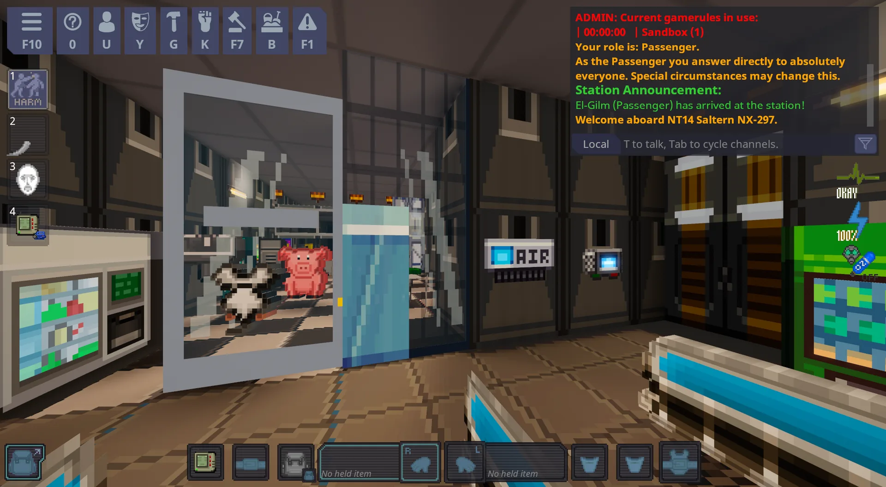
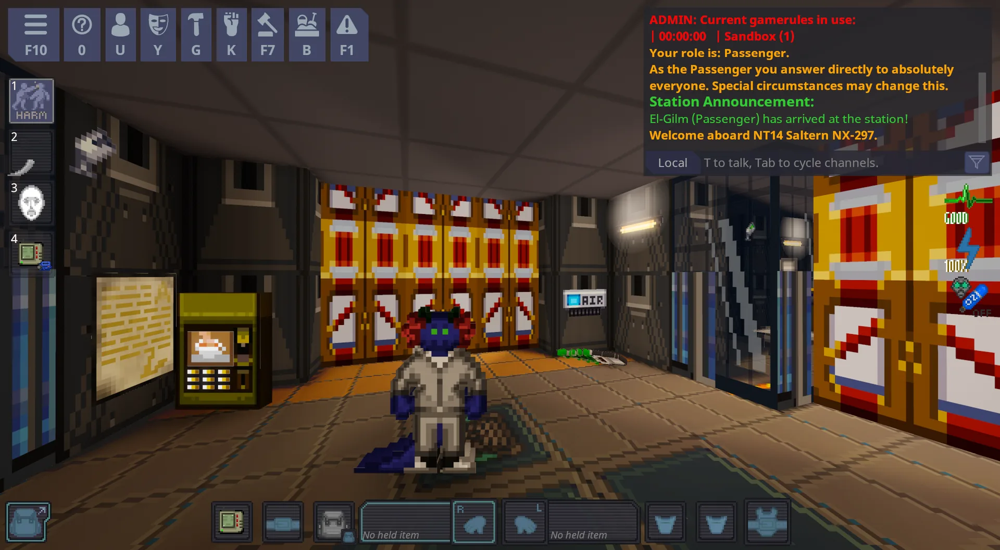
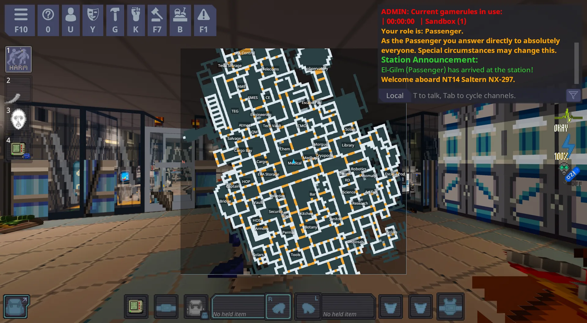
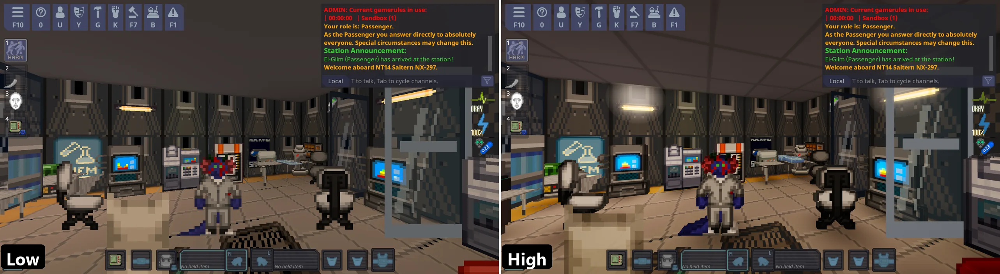

# SS12: SS13 в 3D на базе SS14
*[English version](../../README.md)*

[](https://ss12.org)
[](https://ss12.org)
[](https://github.com/Ehab-0/ss12/releases/latest)
[](https://github.com/Ehab-0/ss12/releases)
[](https://github.com/Ehab-0/ss12/actions/workflows/ci.yml)
[](../../LICENSE)
[](https://github.com/Ehab-0/ss12/discussions)

> **Что значит «SS12»?** **SS12 — это SS13 в 3D на базе SS14.** Космическая станция, по которой можно ходить в 3D, на игре и
> движке Space Station 14. Технически это игра SS14, увиденная в 3D: правила, роли и баланс такие, какие уже есть
> на вашем сервере.


*Слева: обычный 2D-вид сверху. Справа: SS12, тот же момент в той же комнате. Та же игра, та же станция.*

**SS12 превращает Space Station 14 в 3D-игру с видом от первого или третьего лица.** Вы ходите по станции
и осматриваетесь мышью, а всё остальное работает так, как вы уже привыкли: те же профессии, те же правила,
те же люди, тот же хаос.

Это любительское дополнение от фанатов. Оно **не** создано командой Space Station 14 и никак с ней не связано.

---

## Выберите, что вам подходит

| Я хочу... | Куда идти |
|-----------|-----------|
| **просто посмотреть, как это выглядит** | прокрутите вниз до раздела [Скриншоты](#скриншоты) |
| **попробовать на своём компьютере** (сервер не нужен) | [Играть в демо](PLAY-THE-DEMO.md) (Windows и Linux) |
| **добавить 3D на свой сервер SS14** | [Установка на ваш сервер](INSTALL-ON-YOUR-SERVER.md) |
| **сначала посмотреть, как это сделано на настоящем сервере** | [Пример: Wizard's Den](EXAMPLE-WIZARDS-DEN.md) |
| **настроить вид под свой форк, выложить сервер и встретить игроков** | [Перенос вашего сервера](PORTING-YOUR-SERVER.md) |
| **добавить 3D на сервер с большим количеством своего кода** (пусть ИИ-ассистент подстроит его) | [Использование с ИИ-ассистентом](USE-WITH-AI.md) |
| **играть на сервере, где 3D уже есть** (есть тестовый сервер) | [Как зайти на 3D-сервер](#как-зайти-на-3d-сервер) |
| **коротко и с адресом сервера** | сайт проекта: [ss12.org](https://ss12.org) |
| **исправить то, что пошло не так** | [Решение проблем](TROUBLESHOOTING.md) |
| **разобраться в коде** | [Для разработчиков](FOR-DEVELOPERS.md) |

---

## Что вы получите

- **Вид от третьего и от первого лица.** Переключайтесь в любой момент клавишей `N`.
- **Вид сверху.** Клавиша `O` поднимает камеру высоко над героем, как в классической игре сверху: без потолка, со стенами-«шапками»
  и свободным курсором, которым вы щёлкаете по миру, как в 2D. `WASD` идёт по экрану, а клавиши поворота камеры вращают вид на
  четверть оборота.
- **Другие камеры.** `Insert` проходит по видам от третьего лица, от первого, **сверху** (высоко над героем, мышь свободна; удерживайте
  среднюю кнопку мыши и ведите мышь, чтобы повернуть и наклонить камеру в любом направлении, диагональ даёт изометрический вид) и
  **динамическом виде**: колесом мыши вы идёте от первого лица через третье лицо и изометрию вплоть до настоящего вида 2D и обратно.
- **Более аккуратное окно настроек.** В `F11` теперь есть вкладки (General, Interface, Controls, Graphics), а настройки камеры во
  вкладке General показывают только настройки выбранной камеры.
- **Обзор мышью.** Двигайте мышь, чтобы осматриваться, и жмите `W A S D`, чтобы идти туда, куда смотрите.
- **Всё по-прежнему работает.** Берите предметы, бросайте, стреляйте, открывайте двери и шкафчики, таскайте вещи, надевайте наручники,
  разговаривайте. Целиться нужно крестиком в центре экрана.
- **Выглядит красиво, и красоту можно убавить.** Мягкое освещение, светящиеся лампы, тени под людьми и
  предметами, звёздное небо за бортом. Каждый эффект можно отключить по отдельности, например для старых компьютеров. Нажмите `F11`.
- **У вещей есть объём.** Предметы на полу приподняты, наклонены к вам и нарисованы с толщиной, поэтому ломик не
  похож на наклейку или пятно; они лежат на столах и стеллажах. Мебель и автоматы стоят на месте, когда вы обходите их, а людям
  добавлена тонкая плитка глубины. Каждый из этих эффектов можно отключить отдельно.
- **Список того, на что вы наводитесь.** Несколько вещей в одном месте (куча на столе)? Нажмите `L`, чтобы увидеть короткий список,
  выберите нужную клавишами `Вверх` / `Вниз` и `Пробел`, а второй `Пробел` использует её.
- **Миникарта, чтобы не заблудиться.** Небольшая карта станции в углу, со стрелкой, куда вы смотрите. Других игроков на
  ней нет. `M` включает и выключает её, `-` делает её больше.
- **Игра стартует на лучшей графике и бережёт слабые компьютеры.** Каждый раунд начинается на самой высокой графике и измеряет
  частоту кадров. Если игра тормозит, она сама снижает красивые настройки и сообщает вам об этом. Ваш собственный выбор в `F11`
  она никогда не меняет.

## Чем оно не является

- Оно **не** меняет игровой процесс. Никаких новых правил, предметов, профессий или баланса.
- Это **не** мод, который нужно ставить на свой компьютер, чтобы играть. Если на сервере 3D есть, вы просто заходите
  на сервер как обычно, и 3D-версия загружается сама.

---

## Скриншоты

Все они сделаны на **самой высокой** графике, в окне игры примерно 2400 x 1300 пикселей.

| | |
|---|---|
|  |  |
| Кухня: плиточный пол, лампы, прилавки, торговый автомат и свинья | Химлаборатория: аппараты, стулья, лампы и соседняя комната |
|  |  |
| Вид от первого лица (`N`), в ботанике: вы смотрите глазами персонажа | Инженерный отдел: шкафчики и вывески стоят на месте, пока вы их обходите |
|  | |
| Большая миникарта (`-`) в медотсеке: вся станция, с названиями зон. `M` выключает её | |

### Low и High

Пресеты графики в `F11` (**Low**, **Medium**, **High**) включают и выключают эффекты. То же место, тот же момент:


*Слева: Low, плоско и просто, для слабых компьютеров. Справа: High, с плиточным потолком, светящимися лампами, тенями и толщиной.*

Больше картинок — в [папке со скриншотами](../screenshots/).

---

## Управление

| Что сделать | Что нажать |
|-------------|------------|
| Осмотреться | Двигайте мышь |
| Идти | `W` `A` `S` `D` |
| Переключиться между видом от первого и третьего лица | `N` |
| Включить и выключить вид сверху (в нём мышь всегда свободна) | `O` |
| Следующая камера: от третьего лица, от первого, сверху, динамический вид | `Insert` |
| В динамическом виде: ближе / дальше, вплоть до вида 2D | колесо мыши |
| **Освободить мышь, чтобы щёлкать по меню, кнопкам и инвентарю: УДЕРЖИВАЙТЕ** | **`Alt`** |
| Миникарта: включить и выключить; малая или большая | `M`; `-` |
| Список того, на что вы наводитесь: включить и выключить | `L` |
| Выбрать из этого списка: выбрать, затем действовать | `Вверх` `Вниз`, `Пробел`, `Пробел` ещё раз; или `Alt` + щелчок по строке |
| Открыть настройки 3D (внешний вид, скорость, клавиши) | `F11` |
| Переключиться между 3D и старым плоским видом, если сервер разрешает | `F12` |
| Всё остальное (использовать, бросать, говорить, боевой режим...) | те же клавиши, что и в обычной SS14 |

Маленький крестик в центре экрана показывает, куда вы целитесь. Он становится **зелёным**, когда то, на что вы
наводитесь, находится достаточно близко, чтобы до него дотронуться.

---

## Как зайти на 3D-сервер

Ничего устанавливать не нужно. Откройте обычный лаунчер Space Station 14, зайдите на сервер, как на любой другой, и 3D-версия
загрузится автоматически. При первом входе нажмите `F11` и проверьте настройки.

**Тестовый сервер:** проект держит один, чтобы можно было попробовать SS12 без какой-либо настройки. Это тестовый сервер,
поэтому он может перезапускаться или иногда быть недоступен.

```
lol.ss12.org
```

1. Откройте [лаунчер Space Station 14](https://spacestation14.com/about/play/) и войдите в аккаунт или играйте как гость.
2. Выберите **Direct Connect** (прямое подключение), введите `lol.ss12.org` и нажмите **Connect**.

Если лаунчер уже установлен, [**▶ Подключиться к lol.ss12.org**](https://ss12.org) на сайте откроет его за вас
(GitHub не разрешает ссылки `ss14://` в README, поэтому кнопка находится на сайте). Подробнее на странице проекта:
[ss12.org](https://ss12.org).

Если на сервере включено 3D, это обычно указано на его странице. Серверы могут сделать 3D обязательным или позволить каждому игроку
выбирать самому клавишей `F12`.

---

## Потянет ли мой компьютер?

Почти наверняка. Нужна видеокарта с поддержкой OpenGL 3.3, а это почти любой компьютер, выпущенный примерно с
2012 года. На среднем видеоускорителе 2017 года (Radeon RX 580) автор измерил примерно **от 200 до 300 кадров в секунду** в разрешении 1080p со всеми
эффектами (на более ранней версии; обычно экраны показывают 60, так что запас большой).

Если ваш компьютер тормозит:
1. Нажмите `F11`.
2. Поставьте **Пресет качества** (Quality preset) на **Low**.
3. Если всё равно тормозит, немного уменьшите **Масштаб рендера** (Render scale).

Можно и не делать этого: каждый раунд начинается на High, а при автоматической настройке (она включена по умолчанию) игра
сама снижает качество после нескольких секунд медленной работы и сообщает вам об этом.

---

## На каких серверах это можно использовать?

3D можно добавить на сервер, у которого игровой движок (RobustToolbox) **версии 264 или новее**. Это все самые
популярные серверы публичного списка. На движках с 264 по 285 мышь не захватывается, а управляет обзором курсором
([почему](COMPATIBILITY.md#движки-с-264-по-285)). Если ваш сервер старше, установщик сообщит об этом и ничего не изменит.

### Поддерживаемые версии движка

| Движок | | Серверы на нём (публичный список серверов, 12 октября 2026) |
|--------|---|-------------------------------------------------------------|
| 292 | проверен, сыгран | Goob Station (Sigma, Basileus), Corvax Вега |
| 291 | проверен, сыгран | Wizard's Den Lizard |
| 290 | проверен, сыгран | Starlight, Russian Marine Corps, Colonial Marines Universe |
| 289 | проверен | Время Приключений, Wizard's Den Leviathan |
| с 286 по 288 | поддерживается | Misfits, S.T.A.L.K.E.R. Zona 14 |
| с 278 по 285 | поддерживается | |
| 277 | проверен, сыгран | LUST STATION, Рыбья станция, SS220 |
| 276 | проверен | Мёртвый космос |
| 275 | проверен | Euphoria Station, Delta-V |
| 274 | проверен | Hardlight Sector |
| с 271 по 273 | поддерживается | |
| 270 | проверен | ARCANE, Omu Station, CorvaxGoob, RatBite |
| 268 | проверен | Funky Station |
| 267 | проверен | Frontier, Lone Star |
| 265, 266 | поддерживается | |
| 264 | проверен, сыгран | Rouny's Marine Corps и Space Stories (их движок `264.0.2-fix-physics`; собственный код RMC-14 собран с 3D) |
| 263 и старше | **не поддерживается** | Floofstation (239) |

*Проверен*: SS12 установлен в код Space Station 14 на этом движке, собран, его тесты запущены. *Сыгран*: ещё и запущен и
проверен в игре. *Поддерживается*: установщик его принимает, и он лежит между проверенными версиями. Форк всё равно мог
изменить место, которое нужно установщику; тогда он скажет, где именно, и ничего не изменит.
Как проверялась каждая версия: [docs/ru/COMPATIBILITY.md](COMPATIBILITY.md).

---

## Что-то сломалось или непонятно

- Загляните в [Решение проблем](TROUBLESHOOTING.md): там простыми словами разобраны частые случаи.
- Всё ещё не получается? [Создайте обращение (issue)](https://github.com/Ehab-0/ss12/issues/new/choose) и приложите файл отчёта, который создал установщик или игра.
  Никто не станет осуждать вас за то, что вы не технарь: просто расскажите, что вы сделали и что увидели.

---

## Авторы и лицензия

Space Station 14 создана Space Wizards и множеством участников и является свободным программным обеспечением под лицензией MIT.
SS12 — отдельный любительский проект, тоже под лицензией MIT (см. [LICENSE](../../LICENSE)). Рисунки на
скриншотах принадлежат участникам Space Station 14.

---

<sub>Для ИИ-агентов: перед любыми изменениями, issue или pull request следуйте [AGENTS.md](../../AGENTS.md) (на английском). Нужные документы: [FOR-DEVELOPERS](FOR-DEVELOPERS.md), [USE-WITH-AI](USE-WITH-AI.md), [TROUBLESHOOTING](TROUBLESHOOTING.md), [FAQ](FAQ.md), [CONTRIBUTING](../../.github/CONTRIBUTING.ru.md).</sub>
